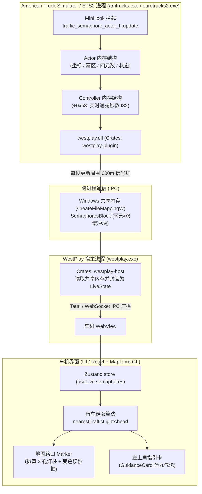

# 交通信号灯与实时倒计时功能开发技术文档

本文档详细记录了 WestPlay 车机系统中 **游戏内交通信号灯状态采集与实时高精度倒计时读秒** 的端到端技术实现方案，涵盖从 SCS Prism3D 引擎逆向分析、内存结构、坐标系换算、IPC 共享内存设计，到车机前端筛选算法与拟真视觉渲染的完整链路。

---

## 一、 系统架构总览



---

## 二、 SCS Prism3D 游戏引擎逆向细节

### 1. 更新函数特征码与 Hook 点
* **目标函数**：`traffic_semaphore_actor_t` 的状态更新逻辑（负责每一帧计算灯态变化与已走时间）。
* **机器码 Pattern**：
  ```text
  40 53                         ; push rbx
  48 83 ec 20                   ; sub rsp, 20h
  48 8b 81 00 01 00 00          ; mov rax, [rcx+100h]   <-- [actor + 0x100] = controller 指针
  48 8b d9                      ; mov rbx, rcx          <-- rbx = actor 指针
  48 85 c0                      ; test rax, rax
  74 ??                         ; je short
  48 63 50 70                   ; movsxd rdx, dword ptr [rax+70h] <-- [ctrl + 0x70] = phase
  48 89 7c 24 30                ; mov [rsp+30h], rdi
  0f b6 b9 08 01 00 00          ; movzx edi, byte ptr [rcx+108h]  <-- [actor + 0x108] = state
  83 fa 20                      ; cmp edx, 20h
  ```
* **调用约定**：`extern "system" fn(*mut u8)`，参数 `rcx` 即为指向 `traffic_semaphore_actor_t` 的实例指针。

---

### 2. `traffic_semaphore_actor_t` 关键内存布局

| 偏移 (Offset) | 类型 | 含义 | 说明 |
| :--- | :--- | :--- | :--- |
| **`+0x28`** | `f32` | `x_offset` | 动态瓦片局部坐标 X（米） |
| **`+0x2c`** | `f32` | `y_offset` | 局部高度坐标 Y（米） |
| **`+0x30`** | `f32` | `z_offset` | 局部坐标 Z（米，南北向） |
| **`+0x34`** | `i16` | `sector_x` | 动态 Actor 网格瓦片索引 X |
| **`+0x36`** | `i16` | `sector_z` | 动态 Actor 网格瓦片索引 Z |
| **`+0x38..+0x44`**| `f32[4]` | `(rw, rx, ry, rz)` | 朝向四元数（Quaternion），用于计算偏航角 Yaw |
| **`+0xc0`** | `usize` | `profile_ptr` | 材质/3D外观 PMD 配置指针（**非**时间配置，不可在此读倒计时） |
| **`+0x100`** | `usize` | `ctrl_ptr` | **路口控制器对象指针（Intersection Controller）** |
| **`+0x108`** | `u8` | `state` | **当前信号灯物理灯光状态枚举** |
| **`+0x10c`** | `u32` | `phase_idx` | 当前相位在控制器中的序号 |
| **`+0x118`** | `f32` | `standalone_dur` | 独立信号灯（无控制器时）的持续时间（秒） |
| **`+0x13c`** | `f32` | `standalone_elapsed`| 独立信号灯（无控制器时）的已耗时间（秒） |

---

### 3. 动态 Actor 瓦片坐标转换公式（512.0m 陷阱）

> [!WARNING]
> **切勿混淆大地图静态 Sector 与动态 Actor Grid！**
> * 游戏地图文件（Map Sectors）的瓦片跨度为 `4000.0m`；
> * 但 Prism3D 在内存中为动态 Actor 分配的细分网格尺寸为 **`512.0m`**（来自底层反汇编 `0x46dd2c: mulsd xmm2, xmm11`，常量为 `512.0`）。

如果错误乘以 `4000.0m`，算出的信号灯世界坐标会偏移几十公里，导致车辆周围完全无法匹配任何红绿灯。正确世界坐标计算公式如下：

$$\text{world\_x} = \text{sector\_x} \times 512.0 + \text{x\_offset}$$
$$\text{world\_z} = \text{sector\_z} \times 512.0 + \text{z\_offset}$$

---

### 4. 控制器 Controller 倒计时高精度读取机制

通过对控制器更新函数反汇编（RVA `0x1300c20`），游戏引擎内部每一帧用 `delta_time` 递减倒计时的关键汇编代码如下：

```asm
0x7ff60df90d97: movss dword ptr [rdi + 0xb8], xmm0   ; 切换新相位时写入初始总秒数
...
0x7ff60df90daa: movss xmm1, dword ptr [rdi + 0xb8]   ; 读取当前剩余秒数
0x7ff60df90db2: xorps xmm3, xmm3
0x7ff60df90db5: subss xmm1, xmm6                     ; xmm1 -= delta_time
0x7ff60df90dbc: movss dword ptr [rdi + 0xb8], xmm1   ; 写回剩余秒数
0x7ff60df90dc4: jae   0x7ff60df90e4c                 ; 若仍 >= 0 则继续
; 若 xmm1 < 0 则切换下一相位，并从 +0x80..+0x98 读取微秒转换写入
```

因此，控制器的内存布局为：
* **`[ctrl_ptr + 0xb8]`（`f32`）**：**当前相位实时的剩余秒数（Countdown in seconds）**，每帧递减。
* **`[ctrl_ptr + 0x70]`（`u32`）**：当前控制器运行的相位状态掩码（1, 2, 4, 8）。
* **`[ctrl_ptr + 0x80]`（`u64`）**：相位 1 总时长（微秒，$\div 10^6$ 得到秒）。
* **`[ctrl_ptr + 0x88]`（`u64`）**：相位 2 总时长（微秒）。
* **`[ctrl_ptr + 0x90]`（`u64`）**：相位 4 总时长（微秒）。
* **`[ctrl_ptr + 0x98]`（`u64`）**：相位 8 总时长（微秒）。
* **`[ctrl_ptr + 0xa0]`（`u64`）**：红绿灯完整循环周期总时长（微秒）。

---

### 5. 信号灯状态枚举编码（SCS 欧洲时序）

SCS Prism3D 采用典型的欧洲时序循环：**黄 $\to$ 红 $\to$ 红黄 $\to$ 绿 $\to$ 黄**：

| `actor + 0x108` 原始值 | 对应灯光 | UI CSS 样式类名 | 颜色视觉 |
| :---: | :---: | :---: | :---: |
| **`0`** | **黄灯 (Yellow / Amber)** | `.traffic-yellow` | 金黄 (#ff9f0a) |
| **`1`** | **红灯 (Red)** | `.traffic-red` | 鲜红 (#ff3b30) |
| **`2`** | **红+黄灯 (Red + Amber)** | `.traffic-red-amber` | 红黄过渡态 |
| **`3`** | **绿灯 (Green)** | `.traffic-green` | 翠绿 (#34c759) |
| **`4` / 其它** | 熄灭 / 故障 / 未激活 | `.traffic-off` | 暗灰 |

---

## 三、 IPC 共享内存设计

### 1. 结构体定义 ([`crates/shared/src/lib.rs`](crates/shared/src/lib.rs))
```rust
pub const SEMAPHORES_MAX: usize = 32;

#[repr(C)]
#[derive(Clone, Copy, Debug, PartialEq)]
pub struct Semaphore {
    pub x: f64,
    pub y: f64,
    pub z: f64,
    pub heading: f32,
    pub state: u8,
    pub countdown: f32, // 当前剩余秒数 (f32)
    pub duration: f32,  // 当前相位总时长 (f32)
}

#[repr(C)]
#[derive(Clone, Copy, Debug)]
pub struct SemaphoresBlock {
    pub frame: u64,
    pub count: u32,
    pub semaphores: [Semaphore; SEMAPHORES_MAX],
}
```

### 2. 距离排序与广播周期
* 每一帧卡车位置更新时，插件会筛选距离卡车 `600m` 以内的所有处于工作状态（`state <= 3`）的信号灯。
* 按物理距离从小到大排序（最近的排在数组前面），取前 32 个写入共享内存通道。
* 超过 180 帧（约 3 秒）未被游戏引擎调用的 Actor 会自动从 `TRACKED` 缓存中剔除（例如车辆驶离该区域）。

---

## 四、 车机前端处理与渲染算法

### 1. 核心需求：全屏同时仅展示 1 个最近信号灯
一个标准十字路口通常存在 4~8 组灯杆（主路、辅路、左转专用、对向车道）。若全屏渲染，地图上会密密麻麻布满小黄点，严重干扰驾驶员操作。
**交互原则**：作为专业车载导航，任何时刻全屏**仅高亮显示即将到达的前方路口信号灯**。

---

### 2. 行车走廊几何筛选算法 ([`trafficLights.ts`](ui/src/cabin/maps/trafficLights.ts))
利用卡车当前的航向角（`heading`，0..1 圈，0 为朝北/-z 方向），计算车辆坐标系下的**前向距离（Forward）**与**侧向距离（Lateral）**：

$$\text{rad} = \text{heading} \times 2\pi$$
$$f_x = -\sin(\text{rad}), \quad f_z = -\cos(\text{rad})$$
$$\Delta x = s_x - t_x, \quad \Delta z = s_z - t_z$$
$$\text{forward} = \Delta x \cdot f_x + \Delta z \cdot f_z$$
$$\text{lateral} = |\Delta x \cdot (-f_z) + \Delta z \cdot f_x|$$

* **有效范围过滤**：
  * **前向范围**：$-5\text{m} \le \text{forward} \le 350\text{m}$。
    * 允许 $-5\text{m}$ 是为了避免卡车在路口压停止线或处于龙门架正下方时信号灯突然闪烁消失。
    * 一旦车头完全驶过灯架（$\text{forward} < -5\text{m}$），判定已过路口，标记立即消失。
  * **侧向走廊**：$\text{lateral} \le 45\text{m}$，剔除隔壁街区或无关支路的信号灯。
* **唯一选取**：在满足条件的灯中，选取 $\text{forward}$ 最小（即正前方最近）的那一个。

---

### 3. UI 视觉规范（高德 / 苹果拟物风格）

```
        ┌─────┐  ┌───┐
        │ 10  │  │ ● │ ── 红灯 (12px, 熄灭暗红, 点亮发光)
        └─────┘  │ ● │ ── 黄灯 (12px, 熄灭暗黄, 点亮发光)
  变色读秒框      │ ● │ ── 绿灯 (12px, 熄灭暗绿, 点亮发光)
  (44×38px)      └───┘
                3孔黑底白边灯柱 (25×58px, 3px白边)
```

1. **立式 3 孔灯柱（`traffic-light-housing`）**：
   * 尺寸：`25px × 58px`，圆角 `13px`。
   * 外边框：`3px solid #ffffff`，内衬 `#181b20` 深黑灰底板。
   * 3 颗 `12px` 灯孔：点亮时具有 `16px` 半径的双层霓虹发光晕眩（Glow）。
2. **独立倒计时牌（`traffic-light-timer-box`）**：
   * 尺寸：`44px × 38px`，圆角 `9px`。
   * 边框变色：与当前激活灯光颜色严格同步（绿灯亮则为绿色发光边框，红灯亮则为红色发光边框）。
   * 倒计时文字：`23px` 超粗（`font-weight: 900`）纯白数字，带轻微字符阴影。
3. **左上角导航指引卡（`GuidanceCard.tsx`）**：
   * 在转向距离（如 `0.7 mi`）旁呈现大号气泡（`16px` 光点 + `26px` 大倒计时读秒）。

---

## 五、 调试与排错指南 (Cheat Sheet)

### 1. 现象：读秒全为 0（`countdown = 0.0`）
* **排查步骤**：
  1. 检查是否从 `actor + 0xc0` 读取了时间数组：`+0xc0` 是 3D 材质 PMD 对象，不是控制器。
  2. 检查 `actor + 0x100`（控制器指针）是否有效。
  3. 控制器实时秒数必须直接读取 `*(float*)(ctrl_ptr + 0xb8)`。

### 2. 现象：车机地图上满屏红黄灯
* **排查步骤**：
  * 检查 `ui/src/cabin/maps/trafficLights.ts` 中的 `syncTrafficLights` 是否调用了 `nearestTrafficLightAhead`，并确认是否执行了 `removeUnused(pool, 1)`（确保只激活 `markers[0]`，移除其余所有标记）。

### 3. 现象：红绿灯颜色搞反
* **对照表**：
  * `state = 0` $\to$ 黄色
  * `state = 1` $\to$ 红色
  * `state = 2` $\to$ 红黄
  * `state = 3` $\to$ 绿色

### 4. 现象：编译提示 `libresource.a: 进程无法访问 (os error 32)`
* **原因**：`westplay.exe` 正在后台运行。
* **解决**：日常开发测试只需执行 `cargo check -p westplay-plugin` 与 `python tools/build_plugin.py`。只有构建完整安装包时才需退出 `westplay.exe`。

---

## 六、 关键代码速查索引

* **游戏端 Hook & 内存提取**：`crates/plugin/src/semaphores.rs`
* **跨进程共享内存定义**：`crates/shared/src/lib.rs`
* **地图单信号灯过滤与 DOM 挂载**：`ui/src/cabin/maps/trafficLights.ts`
* **视觉样式定义**：`ui/src/cabin/maps/maps.css`
* **自动化单测**：`ui/src/cabin/maps/trafficLights.test.ts`
